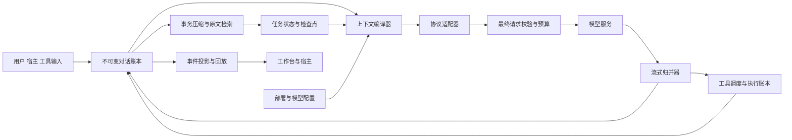

# AetherCore Agent 上下文与推理可靠性设计

状态：目标设计与实施依据；主要运行时链路已进入实现和验证。日期：2026 年 10 月 31 日。代码审计基线：`f287cb57a4f517998fc38a42e0f3e978a8605e99`。实际行为、迁移和验证状态见本文末尾的实施记录；未通过内网真实模型评测前不宣称质量对齐完成。

本文面向运行时、模型接入、前端与宿主集成的开发者。目标是让 AetherCore 在消息保真、推理状态回传、工具循环、长任务、断线恢复和模型兼容方面达到可验证的主流 Agent 工程标准。第一验收对象是内网 vLLM 部署的 DeepSeek V4.1 Flash，同时建立适用于其他模型与协议的基础设施。

核心决策：以不可变的原始对话记录为事实来源，通过上下文编译器生成有限窗口内的请求，通过协议适配器保留模型所需的推理状态，通过统一归并器处理流式输出。压缩改变请求视图，不删除原始证据；重试创建独立尝试，不把不同生成当成同一次输出。

内网模型版本、vLLM 启动参数和实际异常请求尚未接入此环境，相关兼容项须按第 18 节在内网验收。完成设计和通过现有单测均不等于已经达到质量目标。

## 1 质量目标和边界

### 1.1 必须提供的工程保证

1. 用户消息、模型实际返回的内容、工具调用与结果、协议必需的推理状态都有可追溯的原始记录。
2. UI 展示、上下文编译和协议回传分别承担职责。收起思考、清理展示、刷新网页不会删除模型状态。
3. 同一工具循环的依赖不能被拆散；已执行的工具不会因网络重试再次自动执行。
4. 截断、断网、取消和服务重启都有明确状态。部分结果不会被标记成完整成功。
5. 所有影响请求的配置都有生效值、来源、版本和校验结果；最终请求的预算与实际发送内容一致。
6. 历史压缩有来源范围、保留边界、质量校验、原文检索和失败回滚；不能以静默截头代替成功摘要。
7. 运行时、前端和宿主按稳定标识与序号回放事件，恢复后的最终状态一致。
8. 会话、分支和子 Agent 之间的数据传播有显式来源与权限边界。

有限上下文无法永远容纳全部原文，语义摘要也无法证明保留了任意潜在细节。“解决上下文丢失”的验收含义是：不静默永久删除原始数据，不破坏协议状态，任务关键事实有明确保留策略，窗口外证据可以按权限找回。模型最终是否正确使用这些信息，另以质量评测衡量。

### 1.2 对齐范围

本设计涵盖模型请求前后整条链路，也涵盖会影响该链路的宿主上下文、技能、用户追问、子 Agent、文件引用和持久化。搜索质量、编辑算法、沙箱性能等独立能力保留现有实现，只有涉及上下文和工具结果契约时才调整。

不要求复制某个 Agent 的整套提示词、默认温度或内部实现。对齐的是可观察行为、不变量、失败语义和评测结果；“兼容所有 OpenAI 格式接口”不能代替按模型与部署验证。

## 2 主流实现的对照依据

实施参考顺序固定为 Claude Code → Codex → OpenCode → 其他。本地参考分别为 `C:/Work/claude-code`（`4b9d30f7953273e567a18eb819f4eddd45fcc877`）、`C:/Work/codex`（`f752c97f7d0be0cbef5cece327f52a16ad6fb1c6`）、`C:/Work/opencode`（`c10134729dd2ce00beb18604ec91f10319f59a78`）。其中 Claude Code 目录 README 明确说明它是 source-map 公开快照的研究镜像，不是官方开源发布或最新版本证明；参考其思路，独立实现，并以公开协议文档核对要求。

本地重点核对：Claude Code 的 `src/services/compact/grouping.ts`、`compact.ts` 与 `src/utils/messages.ts`；Codex 的 `codex-rs/core/src/context_manager/history.rs`、`compact.rs`、`compact_remote_v2.rs`；OpenCode 的 `packages/opencode/src/provider/transform.ts`、`session/compaction.ts`。Codex 中明确区分历史替换版本、用户输入修订与保留事实，删除历史 item 时维护调用/结果对应关系；这些直接用于 AetherCore 的账本版本、epoch、消息依赖组与事务检查点设计。

以下是公开资料支持的具体行为，后续架构与参数是 AetherCore 的设计决策。来源核对日期为 2026 年 10 月 31 日；分支链接会变化，实施兼容测试时须记录所采用源码的 commit 或发行版本。

| 对照对象 | 可确认的做法 | AetherCore 应采用的原则 |
| --- | --- | --- |
| Claude Code | 接近窗口限制时生成摘要，可指定压缩关注点；官方也说明早期细节可能丢失 | 持久规则单独保存，摘要保留任务与关键证据，提供压缩重点与原文恢复。[来源](https://code.claude.com/docs/en/how-claude-code-works) |
| Codex 本地源码 | ContextManager 保存保留事实及多个修订维度，历史裁剪维护工具对应关系，压缩替换历史后重建必要上下文 | 原始来源、活动窗口、用户目标与运行状态分离；压缩与新输入竞争时检查版本。[源码](https://github.com/openai/codex/blob/f752c97f7d0be0cbef5cece327f52a16ad6fb1c6/codex-rs/core/src/context_manager/history.rs) |
| OpenCode | 当前公开压缩源码使用结构化摘要、近期上下文保留、请求预算与摘要失败处理；公开配置也提供压缩控制 | 运行时实际接入真正的摘要流程，保留近期内容，失败不替换有效上下文。[源码](https://github.com/anomalyco/opencode/blob/dev/packages/core/src/session/compaction.ts)、[配置](https://docs.opencode.ai/docs/config/#compaction) |
| Pi | 压缩结果关联首条保留记录，切分点避免孤立工具结果，并计入思考与工具内容 | 压缩以有依赖的消息组为单位，记录保留位置与来源。[源码](https://github.com/badlogic/pi-mono/blob/main/packages/coding-agent/src/core/compaction/compaction.ts) |
| OpenAI Responses | 推理 item 可带加密状态并参与后续请求；原生压缩返回供下一次使用的上下文窗口 | 原样保留可回传 item；支持原生压缩时保留其完整输出和协议语义。[推理文档](https://developers.openai.com/api/docs/guides/reasoning)、[压缩文档](https://developers.openai.com/api/docs/guides/compaction) |
| Claude Messages | 工具交互需要回传完整 assistant 内容，包含推理签名；部分模型还校验历史前缀 | 保存完整内容数组，保持顺序；将前缀约束作为适配器能力。[工具与思考](https://platform.claude.com/docs/en/build-with-claude/thinking-tool-workflows)、[保留思考](https://platform.claude.com/docs/en/build-with-claude/preserved-thinking) |
| DeepSeek API | 当前携带 tools 的思考模式请求要求回传历史 reasoning_content；部分采样项在官方思考模式下被忽略 | 明确区分官方接口与自部署实现的行为。[来源](https://api-docs.deepseek.com/guides/thinking_mode/) |
| DeepSeek V4.1 与 vLLM | 模型提供专门的提示编码参考；vLLM 提供实际采样惩罚 | 兼容配置必须绑定模型修订版、服务版本、提示模板与解析器，不能只看模型名称。[模型卡](https://huggingface.co/deepseek-ai/DeepSeek-V4.1-Flash#prompt-encoding)、[vLLM 采样](https://docs.vllm.ai/en/stable/api/vllm/sampling_params/) |

Claude Code 文档中的产品行为、Claude API 的协议要求，以及 OpenAI API 的能力分别引用，不能把某个 API 的能力宣称成已经确认的 Agent 内部实现。

## 3 当前链路与审计清单

### 3.1 真正接入运行时的路径

```text
AgentEngine.stream_chat
  → PromptService 组装系统提示与运行状态
  → ContextPipeline.prepare_for_llm
  → ContextMessageAdapter.to_api_messages
  → LlmClient._payload / stream_chat_completion
  → AgentEngine 分别累积正文、展示思考块与工具参数
  → 工具执行或恢复循环
  → session.messages / session.transcript / session.json
  → AgentRunService 持久化 run_events 并推送 SSE
  → Workbench 与宿主展示
```

`ContextManager`、`MessageCompactor`、`ReactiveCompact`、`SessionMemoryCompact`、`PriorityManager` 仍存在并被导出或测试，但当前聊天主循环使用 `ContextPipeline`。不能因为旧类存在、注释写了“LLM 摘要”，就认定生产聊天已具备相应能力。

### 3.2 缺口及处理优先级

“已复现”指离线捕获或确定性样例；“代码确认”指当前路径存在该行为；“待部署验证”指影响取决于服务实现。优先级是整改顺序，不等同于已证明的用户异常根因。

| 编号 | 级别 | 发现与证据 | 影响与目标处理 |
| --- | --- | --- | --- |
| C01 | P0 | 已复现：思考只进入 blocks，模型消息没有 reasoning_content；`engine.py` 思考处理与 `message_adapter.py:make_assistant_message` | 需要回传的推理状态丢失；以原生块和协议 payload 持久化 |
| C02 | P0 | 已复现：length 恢复路径传 content=None，移除 blocks 后成为空 assistant；`engine.py:stream_chat` | 续写看不到上一段；保存部分正文并显式建立 continuation |
| C03 | P0 | 已复现：中途 TransportError 重试前不提交已生成部分；低层与引擎都有重试；`llm_client.py`、`engine.py` | 展示内容与实际上下文不一致；统一尝试与部分提交状态机 |
| C04 | P0 | 代码确认：400、404、422 及多种 5xx 会移除 tools 重试；`LlmClient._should_retry_without_tools` | 改变任务能力、掩盖协议错误；按错误类型处理，移除普遍降级 |
| C05 | P0 | 代码确认：extra_body 最后覆盖 messages、model、tools、max_tokens 等；`LlmClient._payload` | 实际请求绕过预算、身份或工具约束；保护控制字段并统一解析 |
| C06 | P0 | 代码确认：完整性校验仅做基础角色及已见 call_id 检查；`integrity.py` | 未验证重复结果、未完成调用组、必需推理、有效状态；引入协议感知验证 |
| C07 | P1 | 已复现：所谓摘要是前 24 条旧消息各取开头 320 字符；`ContextPipeline._summarize_older_turns` | 原文尾部事实消失；结构化摘要与原文归档 |
| C08 | P1 | 代码确认：长字符串工具结果可整体替换为清除标记；`_truncate_tool_content`、`truncate_tool_result` | 缺少稳定恢复引用；存完整结果并生成有引用的受限视图 |
| C09 | P1 | 代码确认：压缩替换 session.messages 并持久化；transcript 是展示记录而非完整协议档案 | 缺少独立、完整的可重编译来源；保存不可变原始账本 |
| C10 | P1 | 代码确认：既有 compact_summary 被列为 critical，后续摘要继续保留 | 多次压缩可能不断累积旧摘要；用可追溯的新检查点取代旧活动检查点 |
| C11 | P1 | 代码确认：默认发送 temperature=0.7、frequency=0.4、presence=0.3；未配置 reasoning 默认为 high | 全模型共享有偏参数；按模型配置及显式用户意图解析 |
| C12 | P1 | 代码确认：sampling 字段跨全局、平台、用户合并，缺少 model/deployment 适用域 | 切换模型后沿用不适配参数；模型配置分域与切换检查 |
| C13 | P1 | 代码确认：只有 OpenAI Chat 格式，provider_kind 标为 litellm 但调用实际为 httpx | 缺少原生 Responses、Messages 状态表达；显式适配器，保留旧标识迁移别名 |
| C14 | P1 | 代码确认：工具请求统一添加非通用 tool_stream；effort 使用固定字符串排序映射 | 网关拒绝或错误语义映射；版本化能力配置，数值与枚举分别支持 |
| C15 | P1 | 代码确认：上下文窗口依赖模型名目录，未知模型默认 200K；未绑定实际部署限额 | 内网别名或 max_model_len 与目录不一致；部署限额优先 |
| C16 | P1 | 代码确认：预算在最终 payload 前计算，估算不包含独立 reasoning_content；max_tokens 可被覆盖 | 回传思考修复后仍会低估；对实际序列化请求计数 |
| C17 | P1 | 代码确认：usage 在存在工具调用时不能保证走到末尾更新；未统一请求流末尾 usage | 长工具循环缺少校准；每次 attempt 都记录 usage |
| C18 | P1 | 代码确认：SSE 忽略 JSON 解析失败，不要求有效终止；DONE 仅 continue；choices 默认取首项 | 可能静默丢片段、误判完成；严格解析与终止语义 |
| C19 | P1 | 代码确认：元数据清理使用排除列表，所有普通 system 消息汇总到开头；`to_api_messages` | 未知字段泄露到请求，运行提示失去时间位置；适配器允许列表和有序控制事件 |
| C20 | P1 | 代码确认：每步重建系统提示、运行状态及动态工具列表；前缀约束影响待适配验证 | 对有签名绑定的模型需冻结前缀或原生更新/压缩 |
| C21 | P1 | 代码确认：前端以临时块标识累加 delta，stream_retry 重置标识但保留旧块 | 不同尝试边界不清；稳定 part_id、attempt_id 与幂等 reducer |
| C22 | P1 | 代码确认：后端已有 run_id/seq 和持久化回放，前端通用读流处未统一去重及多行 SSE 解析 | 保留已有底座，补统一重放、断序与快照恢复契约 |
| C23 | P1 | 代码确认：session JSON 原子替换与 run_events SQLite 提交是分开的 | 崩溃时两种视图可能落在不同进度；事务账本加可重建快照 |
| C24 | P2 | 代码确认：估算、压缩和文档并存多套语义；部分测试只断言重试次数/成功 | 通过测试未覆盖实际请求保真；统一生产路径与契约测试 |

另需覆盖宿主上下文大小、技能加载记录、交互提问恢复、子 Agent 结果来源、附件生命周期和模型切换。它们作为第 12、13、17 节的验收场景，不在缺少复现的情况下认定为现有根因。

### 3.3 已有基础应保留

保留 Workspace 与会话隔离、数据库中的运行锁、`run_events(run_id, seq)`、用户输入提交事件、宿主工具目录版本、session JSON 原子写入以及独立 runtime_state。改造接入这些能力，避免另建一套竞争的会话服务、事件系统或沙箱路径。

## 4 目标架构



采用模块化单体：复用现有 FastAPI、SQLite 与本地存储，不为此引入消息队列、向量库或独立微服务。只有清晰的数据契约先成立，后续扩展才有可靠基础。

| 模块 | 责任 | 不应承担的责任 |
| --- | --- | --- |
| ConversationRepository | 账本、修订版本、原文、检查点引用、事务提交 | 拼接提示词、改变模型文本 |
| ContextCompiler | 选择活动历史、任务状态、依赖闭包与恢复引用 | 修改原始记录、自行猜测供应商语义 |
| ProviderAdapter | 原生字段、思考回传、序列化、usage 与错误归一化 | 无提示删除工具、从 UI 反推协议状态 |
| StreamReducer | 对某次尝试归并有序块、验证完成、产生标准事件 | 自动重发网络请求或执行工具 |
| RunOrchestrator | 工具循环、重试与续写策略、取消、预算 | 手工解析每个供应商的 JSON |
| CompactionService | 安全切分、摘要、质量校验与检查点提交 | 覆盖原文、凭失败摘要继续 |
| TranscriptProjector | 生成 UI 和宿主所需的投影 | 作为模型历史的事实来源 |

`ContextPipeline` 演进为编译器入口；`AgentEngine` 逐步委托上述组件，避免一次重写整套运行时。

## 5 消息与生命周期契约

### 5.1 标识与层级

| 标识 | 含义 |
| --- | --- |
| conversation_id / branch_id | 对话及显式分支；跨分支传播必须有引用 |
| turn_id | 一次用户任务或明确的后续用户输入 |
| run_id | 现有运行标识，可因等待用户继续保持或创建后续运行 |
| step_id | 一次模型决策，可能产生文本、工具调用或结束 |
| attempt_id | step 内一次实际请求；重试不得复用已失败尝试身份 |
| continuation_of | 明确连接截断后继续的消息或尝试 |
| message_id / part_id | 原始消息与有序内容块，跨流式、刷新和回放保持稳定 |
| context_epoch_id | 压缩、分支或协议绑定重置后的上下文阶段 |
| revision / seq | 会话并发修订及运行事件序号，不能相互替代 |

### 5.2 内部规范模型

下面是契约示意，不是直接写入现有 schemas 的实现代码。

```typescript
type MessageRecord = {
  schemaVersion: 3;
  conversationId: string;
  branchId: string;
  messageId: string;
  turnId: string;
  runId?: string;
  stepId?: string;
  attemptId?: string;
  contextEpochId: string;
  role: "system" | "developer" | "user" | "assistant" | "tool";
  origin: "user" | "operator" | "model" | "host" | "tool" | "subagent";
  parts: ContentPart[];
  status: "streaming" | "completed" | "incomplete" | "aborted" | "failed";
  stopReason?: string;
  continuationOf?: string;
  providerBinding?: ProviderBinding;
  nativePayloadRef?: string;
  sourceRefs: SourceRef[];
};

type ContentPart =
  | { id: string; type: "text"; text: string; phase?: string }
  | { id: string; type: "reasoning"; text?: string; replayRef?: string }
  | { id: string; type: "opaque"; nativeType: string; payloadRef: string }
  | { id: string; type: "tool_call"; callId: string; name: string;
      argumentsRaw: string; argumentsParsed?: unknown }
  | { id: string; type: "tool_result"; callId: string; resultRef: string;
      status: "success" | "error" | "unknown" }
  | { id: string; type: "attachment"; artifactId: string; contentHash: string };
```

`ProviderBinding` 保存协议、部署配置 ID、模型修订版、账户引用、模板/适配器版本和前缀指纹，不保存 API Key。`SourceRef` 保存来源消息、块、工具结果及字节或行范围。

推理显示文本与可回传状态可以不同：加密推理、签名、redacted thinking 和未知原生块必须保留其协议结构。服务没有返回的内部思考不能重建或要求模型补写。`reasoning_content`、`reasoning` 等字段的映射由 profile 确定，不能全局用 `or` 合并而丢掉合法空值或并存字段。

### 5.3 三种投影

原始账本保存实际记录；模型投影按照协议选择并序列化；UI 投影控制展示、折叠和进度。三者共享稳定标识，但不能互相覆盖。展示摘要不得代替签名原文，完整 UI transcript 也不能被当作完整模型协议历史。

自定义内部事件如用户提问答案、子 Agent 通知和系统恢复指令必须注册编译规则。未知事件应明确失败或保留在审计侧并报告，不得因角色不在允许列表中静默消失。

## 6 协议适配与思考回传

### 6.1 接口边界

```python
class ProviderAdapter(Protocol):
    def capabilities(self, deployment) -> ResolvedCapabilities: ...
    def compile(self, context, generation) -> PreparedRequest: ...
    def validate(self, request) -> ValidationReport: ...
    def count_tokens(self, request) -> TokenEstimate: ...
    def decode_event(self, frame) -> list[NormalizedStreamEvent]: ...
    def finalize(self, accumulated) -> NativeAssistantRecord: ...
    def replay_policy(self, binding, phase) -> ReasoningReplayPolicy: ...
    def classify_error(self, response_or_exception) -> ProviderFailure: ...
```

网络传输只发送已经冻结的 `PreparedRequest`。编译、计数、日志摘要、请求指纹和实际 POST 必须指向同一请求对象；不能在发送时再执行任意 payload.update。

### 6.2 初始支持矩阵

| 适配器 | 必须保留的状态 | 规则 |
| --- | --- | --- |
| OpenAI Chat | content、tool_calls、经过配置确认的 reasoning 字段 | 基础格式允许列表；未知供应商字段留原始记录，只有声明的扩展才发回 |
| DeepSeek 官方 Chat | reasoning_content 与工具消息 | 按已验证版本处理所有需要回传的历史；不把纯聊天规则套到工具循环 |
| vLLM Chat | 与部署模板/解析器匹配的文本推理、调用及标记 | 不默认复制官方服务行为；测试模板、思考模式、effort、工具解析的组合 |
| OpenAI Responses | 全部可回放 output items、phase、call_id、加密推理与原生 compaction items | 明确选择客户端回放或服务端链式状态，避免重复追加同一历史 |
| Claude Messages | 原始有序 content 数组、thinking/signature/redacted 及协议扩展 | 保留合法空块；模型/账户与前缀绑定按版本校验；工具结果映射由适配器负责 |

第一阶段完成 Chat 与 vLLM 的保真，下一阶段接入 Responses 与 Messages。只有各自通过协议契约测试与真实服务验收后才标为“已支持”；设计了接口不能当作完成适配。

Responses 使用服务端链式状态时保存 response lineage 与可回放的本地原生 items。服务端状态过期、账户变更或链断裂时，只有本地具备完整合法状态才可切为客户端回放；否则明确建立新 epoch 并交接任务状态。不得把供应商曾保存过历史等同于 AetherCore 已经具备可恢复副本。

### 6.3 思考保留策略

策略语义区分不回传、当前工具循环、全部可回传状态和原生 items。实际配置为 Chat 的 `reasoning_replay=auto|disabled` 与 `reasoning_field`，不暴露一组没有运行实现的策略名称。`auto` 保存并回传全部可用文本思考；DeepSeek 思考模式携带工具时强制包含所有历史 assistant 的 `reasoning_content`，包含空字符串及跨用户轮次；原生协议始终回放原生状态。原始账本仍保留收到的状态，UI 是否显示思考不影响回传。

切换模型、账户、协议、模板或压缩阶段时，重新验证绑定。不能把供应商 A 的签名、加密状态或专用 token 传给 B；允许复用的明确兼容组合由 profile 声明。无法复用时建立新 epoch，以可读的任务状态和证据引用交接，不伪造思考。

对要求前缀不变的模型，顶层指令和工具目录冻结。动态状态采用供应商支持的追加机制；不支持时在安全边界建立新 epoch。客户端压缩不得保留绑定到已删除前缀的过期推理块；需要使用原生压缩或一次明确的状态重置。

## 7 部署能力和参数解析

### 7.1 模型不等于部署

`DeploymentProfile` 至少记录：服务种类及版本、endpoint 引用、served_model_name、模型 family/revision、tokenizer revision、chat template/编码器摘要、reasoning parser、tool parser、思考模式、上下文上限、输出上限、支持参数、usage 语义、SSE 规则与协议版本。

模型能力目录提供候选信息，不能覆盖实际 vLLM 的 `max_model_len`、服务端生成配置和模板。内网可手动填写与导入 profile，不强制依赖 models.dev 或公网访问。通过 `/models` 只能确认其实际返回的字段，不能据此认定工具或思考兼容。

能力发现分“已声明”“离线协议测试通过”“真实服务验证通过”三个状态。验证使用无副作用的测试工具；不在普通聊天启动时偷偷执行长评测或修改服务器配置。

### 7.2 参数三态与适用范围

每个可继承参数使用三态：`inherit` 继承当前模型适用的上层配置、`model_default` 显式停止继承并采用经验证的模型/服务默认、`value` 使用明确值。旧 null 映射为 inherit，显式 0 必须保留。

解析顺序为：部署与模型基线 → 适用该模型的全局配置 → 平台 → 用户 → 本次请求 → 能力与硬限额验证。每层可声明 model_default；跨模型不继承原模型专有的 penalty、effort、stop 或模板参数。所有覆盖都记录来源，不静默夹取、不把不支持值映射成“差不多”的其他力度。

新配置的通用 temperature、top_p、effort 默认采用模型配置，不统一强制 high。通用请求不主动加非零惩罚；经验证的 vLLM 中性配置可明确发送 frequency=0、presence=0、repetition=1。不能假设所有服务省略字段后的默认值都相同。

不把 temperature=0 当通用精度修复；DeepSeek V4.1 的官方采样建议应作为对应 revision 的候选基线，再验证本地服务是否采用同样的生成语义。惩罚主要作用于当前生成，不应解释为随用户聊天轮数无限累积。

### 7.3 生效请求与保护字段

将 max_output_tokens、reasoning 模式/力度、stop、seed、stream_usage、parallel_tool_calls 和上下文限额纳入受校验配置。effort 类型支持 profile 指定的枚举或数值范围；输出字段名由协议适配器映射。

`extra_body` 迁移为 `provider_options`。messages/input、model、tools、tool_choice、stream、输出预算、连接目标和控制标识由运行时管理。旧配置中这些键必须显式归入受管字段并重新校验，或返回可理解的迁移错误；不能继续提供覆盖漏洞。

允许的服务扩展须登记类型、影响范围及计数方式；影响 prompt 或生成预算的扩展在最终计数前解析。`tool_stream` 等扩展只对声明支持的部署发送。

生效结果至少提供 `value`、`source`、`sent_as`、`status`、`reason` 与 profile revision。设置界面显示“继承自哪里”“采用模型默认”“不支持/被服务忽略”，并支持重置到对应模型基线。

## 8 上下文编译与预算

### 8.1 单一编译流程

```text
冻结会话 revision、profile、指令与工具目录版本
→ 加载当前 epoch 的有效检查点与其后的原始记录
→ 纳入当前任务、用户更正、交互答案和必要证据
→ 计算消息与工具调用依赖闭包
→ 按 provider 策略选择合法推理状态
→ 构造原生请求并校验
→ 对最终序列化请求计数
→ 如有压力则执行事务压缩，再完整编译
→ 生成冻结的 PreparedRequest 与 manifest
```

`manifest` 保存输入消息/块引用、检查点、排除原因、工具版本、profile、配置来源和预算明细。能解释“某段内容为什么没有发给模型”，但不把内部调试信息塞进用户任务提示。

### 8.2 预算公式

```text
C = min(已知模型上限, 部署上限, 管理策略上限)
O = 经过验证的本次输出预留
S = 模板开销与计数误差安全余量
B = C - O - S
输入 token = 实际可回传消息 + 推理 + 系统/开发者指令
             + 工具 schema + 附件原生开销 + 协议包装
必须满足：输入 token <= B，且独立输入/输出限制各自满足
```

共享输出额度的协议将正文和 reasoning 放在同一 O 中；提供独立思考预算的协议按其规定映射，不能统一相加或重复预留。B 非正时返回配置错误，不能用 max(1, ...) 假装仍可请求。

计数优先使用经过验证的服务计数接口或完全匹配的 tokenizer 与编码器；其次使用该部署的校准估算；最后使用有标识的保守估算。未知窗口必须显式配置或采用标明为未验证的保守限制，不能把 200K 当已知事实。

签名、加密推理和原生 compaction item 的传输长度不等于模型展开后的 token 数。不能直接拿密文字符数或本地 JSON 大小宣称精确计数；采用供应商计数/usage 语义、已知的保守上界或显式未验证状态，并据此预留空间。

首版建议在 B 的 75% 预警、85% 触发主动准备摘要、95% 强制阻断并压缩，压缩后目标 60%～65%。这些是起始策略，必须根据单步最大工具结果、输出预算与部署评测调整；不能等到完全溢出才发现摘要请求也放不下。并发预计算在正确性完成后再启用。

### 8.3 usage 规范化

统一保存 input_total、input_uncached、cache_read、cache_write、output_total、reasoning_output、计费数据与原始 usage。明确每个供应商哪些字段是包含关系，避免重复相加。每次模型请求结束、工具交接、失败但有 usage 时都提交，不能只在最终回答处提交。

计数校准键包含部署、模板、工具目录、模态、推理模式与编译版本。压缩或模型切换后，旧请求的 usage 不能直接当新视图大小。追踪误差区间与突增原因，不能单靠 0.5～3 的全局系数隐藏系统性漏计。

## 9 历史压缩与任务记忆

### 9.1 四层信息

1. 原始账本：不可变协议记录与工具完整输出，有保留政策与权限。
2. 近期工作集：当前任务与最近完整交互，按 token 和依赖组保护，不仅按轮数。
3. 任务状态：用户当前目标、约束、更正、明确决定、待办、问题与证据引用。
4. 历史检查点：结构化摘要与完整来源范围，用于替代已经覆盖的活动窗口。

任务记忆是当前对话状态，不自动写入跨用户的长期记忆。用户纠正值时保留更正事件和 supersedes 关系，不把旧值和新值不加区分地重复塞入系统提示。

### 9.2 安全压缩顺序

先在投影中去除重复的派生快照，再缩小旧的可恢复工具视图，再压缩已完成的历史消息组。当前用户任务、未闭合工具循环、尚未执行/确认的操作、最新用户答案、当前安全边界和必要推理状态不能被普通截断器拆开。

超大当前轮不能靠“保护最近四轮”解决：先将完整工具数据归档，返回有范围与引用的片段；对已结束的 step 建立任务内检查点。单条用户输入过大时提供附件化或明确的选择方式，不能静默只发前半段。

### 9.3 事务化摘要

```text
取得 source_revision 和安全切分点
→ 确认 source_range 内原始记录、工具与附件已持久化
→ 生成压缩候选，保留近期工作集
→ 以独立、无工具执行权限的摘要任务分块总结
→ 校验格式、来源覆盖、关键事实、依赖和预算
→ 试编译完整下一次请求
→ CAS 比较 source_revision / 指纹
→ 同事务提交 checkpoint、活动边界与事件
```

并发到达的新输入不应被旧快照覆盖。允许保留已完成前缀的候选、将新尾部重新拼接并完整校验；不能满足时放弃候选重算。失败、拒答、空输出、长度截断或预算未下降的摘要都不能提交为成功检查点。

摘要任务有单独的重试、耗时和 token 上限，禁止再次递归触发同一压缩。源内容放不进单次请求时采用分块摘要再合并，所有分块都记录覆盖范围；不能把来不及处理的历史直接称作已摘要。

### 9.4 检查点结构与事实保真

```json
{
  "checkpoint_id": "cp_...",
  "source_revision": 42,
  "covered_ranges": [{"first": "msg_a", "last": "msg_m"}],
  "first_kept_message_id": "msg_n",
  "previous_checkpoint_id": "cp_previous",
  "goal": "当前任务",
  "constraints": [{"text": "用户约束原文", "source_refs": ["msg_a"]}],
  "facts": [{"kind": "ip", "value": "192.0.2.10", "source_refs": ["msg_b"]}],
  "decisions": [],
  "completed_work": [],
  "pending_work": [],
  "open_questions": [],
  "evidence_refs": [],
  "uncertainties": [],
  "profile_revision": "profile_...",
  "validation": {"coverage": "passed", "dependencies": "passed"}
}
```

IP、URL、端口、路径、版本、命令、标识符和用户要求原样保留的字符串，按任务需要存为有来源的原文事实。使用跨度复制与一致性校验，不能让摘要模型重新拼写它们。正则发现的字符串只是候选，不代表所有历史数字都要永久塞入窗口；不确定重要性时保留原文引用并支持检索。

已完成、待处理、猜测和实际工具观察必须分开。摘要不能把工具建议写成用户授权，也不能把“准备执行”写成“已经成功”。任务状态有体积上限和原文索引；不能让 pinned facts 成为第二个无限增长的上下文。

同一 epoch 只保留一个活动检查点，其 predecessor 用于审计。新检查点合并旧检查点与新增已完成历史，原始记录仍可追溯，避免重复摘要越来越厚。供应商原生 compaction 输出独立按协议保存，不套用可读摘要 JSON 的重排规则。

### 9.5 原文恢复

提供 `conversation_search`、`conversation_read`、`tool_result_read` 或等价内部能力，按消息/结果 ID、行范围及来源检索。优先实现 SQLite/关键词与范围读取，无需先建向量库。

检索沿用对话权限与分支可见性，不能因为共享 Workspace 就跨会话读取推理。删除对话或附件时同步删除或清理相应归档和索引；检查点中失效引用必须显示不可用，不把不存在证据当作已知事实。

## 10 流式输出和恢复状态机

### 10.1 一次尝试的状态

```text
prepared → requesting → streaming → completed
                          ├→ incomplete_length → continuation step
                          ├→ interrupted       → partial commit + recovery decision
                          ├→ tool_handoff      → tool execution group
                          ├→ refused/filtered  → explicit terminal outcome
                          └→ aborted/failed    → partial commit + terminal event
```

每次尝试独立保存 finish reason，不能继承上一轮的 length。正文、思考、调用参数和签名属于同一个有序响应，记录 block index 与原生 item identity；不能只将各类文本分别累加而失去相对顺序。

只有工具参数完成、JSON 与 schema 验证通过、调用组合法时才能执行。半截 JSON 不能尝试“修复后照常执行”。需要模型修正时返回明确错误或在新的决策步骤中请求修正。

### 10.2 错误与恢复矩阵

| 场景 | 处理 | 禁止行为 |
| --- | --- | --- |
| 输出前连接失败、429、可重试 5xx | 同一冻结请求，按 Retry-After/退避与总预算新建尝试 | 修改工具或提示词来“碰碰运气” |
| 已有正文/思考后断线 | 持久化部分内容，标记 interrupted；协议允许时有界继续，否则显式重试分支 | 将新生成直接接在旧文本后当成同一次完成 |
| finish_reason=length | 保存全部已收到内容与原生状态，建立 continuation_of，并重新计算剩余额度 | 空 assistant 历史、无限自动续写 |
| 仅思考后正常终止 | 保留原生状态，至多一次明确恢复尝试；仍无正文则 incomplete | 反复 system 提醒直到耗尽全部轮数 |
| 有效工具交接 | 提交 assistant 后执行工具组，提交所有结果后继续 | 将工具交接误当空回答 |
| 参数/签名/模板/模型错误 | 配置或协议错误，给出具体诊断 | 按任意 400 删除推理、工具或输出限制 |
| 上下文溢出 | 重新计数、事务压缩后有限次数重试 | 删除必要消息或在已执行工具后重跑旧步骤 |
| 畸形 SSE、序列异常、EOF 无有效完成 | protocol_error/incomplete，保留部分状态 | 静默跳过并返回 success |
| 拒答、过滤、用户取消 | 明确终态与部分记录 | 自动重试以改变拒答/取消结果 |

统一重试由 RunOrchestrator 负责，HTTP 层不另建语义降级循环。初始建议：输出前重试最多 3 次且累计等待不超过 60 秒；传输后恢复最多 1 次；每个用户 turn 自动 length 续写最多 2 次；overflow 重试最多 2 次。所有尝试共享运行总时限、总 token 和费用预算，达到上限返回明确 incomplete，配置上限不能用零歧义地表示无限。

错误类型至少区分 ConfigurationError、ContextIntegrityError、ContextOverflowError、ProviderProtocolError、ProviderUnavailable 和 RecoveryBudgetExceeded。完整性失败不得像当前实现一样包装成 overflow 后再尝试靠压缩解决。消息序列以合法工具结果组结尾，本来就是等待 assistant 继续的正常请求形态，不能因此误报错误。

对不支持原生续写的 Chat 部署，可以回传合法的部分正文并追加有来源的继续指令，但这只是新的生成，不保证 Markdown/代码字节连续。合并前仅在有明确偏移或精确重叠证据时处理重复；不使用模糊去重改写模型正文。结构化 JSON 或工具参数优先重新生成整个目标并显式替代旧版本，保留旧记录。

### 10.3 SSE 解析规则

统一后端和前端的帧语义：增量 UTF-8、CRLF/LF、跨网络块缓冲、多行 data、注释/心跳、尾部残片、供应商 error frame、无 choices 的 usage 帧与终止事件。合理限制帧大小和空闲时间。

DONE 是该协议的终止信号，不继续消费后续生成；缺少 finish reason 是否仍合法由适配器明确规定。部分兼容服务的允许差异写入 profile 并测试，不能靠吞异常兼容。请求固定 n=1；多候选输出不在现有聊天语义中隐式开启。

## 11 工具循环与副作用

工具调用生命周期为 proposed → validated → committed → executing → succeeded/failed/unknown/cancelled。记录 operation_id、call_id、来源 attempt、目录版本、输入摘要与结果引用。operation_id 在确定的调用提交时创建，重试/重启沿用，不能只凭命令文本判重复。

并行调用以依赖组提交：保留全部 call IDs，等待每个结果或明确的错误结果，再按协议顺序生成下一次请求。工具错误是结果的一种，不能删去导致孤立调用。权限改变或目录撤销时，按已经提交的版本验证执行授权；无法执行则返回明确工具结果。

对本地与宿主支持幂等的工具传递 operation_id；已完成的操作复用持久化回执。进程在“外部执行完成、结果未写回”之间崩溃时，无法对任意外部系统保证 exactly-once。此时先查询宿主回执或核对实际状态，不自动重放有副作用工具；标记 unknown 并进入恢复流程。

模型重试、浏览器重连和工具重试必须分开。不能因为 UI 未收到结果就重新调用模型，也不能因为模型请求超时就再次执行已完成工具。

## 12 提示词和动态上下文

稳定指令、任务数据、工具观察和模型猜测分别保存来源与信任等级。宿主页面内容、文件和子 Agent 输出不能因被拼进 system 就获得管理员指令权限。

冻结规则模板版本，并限制 host_context、技能目录、工具描述和文件列表的预算；优先按需读取，超限给出索引与引用。不得为减少 token 改写 IP、URL、命令或路径。中文偏好是用户/平台配置，代码、标识符与引用原文允许保留原语言；没有必要通过大量重复中文指令“压住”语言漂移。

动态运行状态以有版本的 ControlNotice 或 TaskStateUpdate 表达，按协议合法位置编译。已过期的续写提醒不永久提升到顶层 system；对于签名前缀绑定协议，采用原生的作用域更新或在边界重建 epoch。

技能加载记录保存技能版本、来源和有效范围。压缩后保留仍然适用的约束或可恢复引用，不能只保留“调用过 invoke_skill”却忘记必须遵守的工作流。任务切换时清理适用范围，不自动继承前任务全部技能文本。

用户对交互问题的答案必须作为可编译的确定事实保存，包含 request_id、问题、选中值/原文和时间；停止、超时及预选项不是同意。模型后续步骤可以看到完整答案与未解决问题，不能只依赖 UI 事件。

## 13 子 Agent 和会话边界

保持现有 Workspace 共享与会话上下文隔离。子 Agent 接收显式任务包：目标、约束、允许工具、必要事实、证据引用、父任务 revision 与预算，不复制父模型的专用思考或签名。

结果交接包含已完成工作、证据、文件及版本/哈希、剩余事项、失败和不确定性。父 Agent 按工具/子 Agent 来源消费结果，不把子 Agent 文本提升成 system 权威。销毁子 Agent 后，已授权交接的结果仍有独立来源记录；私人推理仍按其生命周期管理。

子 Agent 结果、宿主状态更新和用户输入并发到达时，通过会话 revision 与有序 inbox 接入。摘要基于旧 revision 时不能覆盖这些新消息。数据库运行锁扩展为可恢复租约/代次校验，过期 worker 不能继续提交旧输出。

## 14 持久化与崩溃一致性

### 14.1 复用现有存储的增量表

| 记录 | 关键字段及约束 |
| --- | --- |
| conversation_records | conversation/branch、record_id、revision、message/part payload、来源；会话修订唯一 |
| model_attempts | attempt_id、step_id、context_epoch、请求指纹、profile、状态、stop reason、usage |
| tool_executions | operation_id 唯一、call_id、attempt_id、输入摘要、执行状态、回执与结果引用 |
| context_checkpoints | checkpoint_id、source_revision、覆盖范围、first_kept、前驱、质量状态 |
| context_epochs | epoch_id、provider binding、活动检查点与最小读取版本 |
| replay_artifacts | artifact_id、归属、哈希、类型、大小、存储引用与保留政策 |

继续复用 `agent_runs` 和 `run_events`。新增记录的内容完成、attempt 状态、工具回执及对应事件在同一 SQLite 事务提交。运行事件包含稳定记录引用与必要展示投影，而不是另一个可以独立改写的消息事实库。

`session.json` 演进为可重建快照，记录 ledger_revision；仍保留当前 `backend/storage/sessions/session-state/<session_id>/` 路径。大工具结果和协议 payload 存为会话归属的内容寻址文件，由事务记录引用；先落盘并校验文件，再提交引用，孤儿文件由受限 GC 回收。引用失效时明确报错。

### 14.2 增量输出持久化

为控制写放大，可按短时间或字节阈值批量提交流片段。对外发布的 delta 必须已经进入可恢复日志，完成块与终态必须事务提交；批量窗口是吞吐与显示延迟的配置，不允许先把不可恢复文本当已提交内容推给客户端。

重启后由原始记录、attempt 状态与工具账本重建。已完整完成的响应不会重新请求；半途响应标记 interrupted；工具状态 unknown 先核对回执；终态事件缺失可以幂等补发。JSON 快照、数据库事件和 UI 不一致时按账本 revision 修复。

### 14.3 数据访问与保留

原生思考与加密/签名块只用于协议回放与受控诊断，不进入宿主预览或跨会话全文索引。记录归属、访问审计与保留期限。按部署数据政策使用现有密钥管理机制或独立配置的数据加密；密钥不能落入日志、检查点或浏览器。

原始账本在正常运行中不可变，用户删除与明确保留政策是其生命周期操作，不承诺无限保留。删除需覆盖索引、派生快照、归档和加密 payload；仍受保护或不能立即删除的备份行为在部署政策中说明。

## 15 事件 前端与宿主协议

在现有事件上增加可协商版本。核心 envelope 至少包含 protocol_version、session_id、run_id、seq、turn_id、step_id、attempt_id、message_id、part_id、context_epoch_id 与 event_id。旧事件通过桥接投影兼容，不能让旧前端看到不了解的原生推理 payload。

前端统一 reducer 依据 `(run_id, seq)` 去重并校验会话归属；按 part_id 更新，明确 started/delta/completed/incomplete/replaced，不能按 Date.now 猜块身份。序号缺口触发补拉或已知 revision 的快照恢复，不能直接丢掉乱序数据。快照附最后应用序号，后续只回放其后的事件。

重试属于新的 attempt；续写具有 continuation_of；显示部分结果、替代关系和失败原因。旧尝试可以折叠，但不得在 UI 中假装不存在或串成一段完成文本。展示过的文本和重新打开会话后的文本必须一致。

宿主预览仍只接收用户可见正文。增强预览协议时增加 attempt_id、part_id 和状态，确保被替代/失败尝试不会覆盖新的有效结果；保持当前接入 opt-in 与框架无关的适配器。同步修改 `host-adapters/universal/` 测试、生成集成示例和相关协议文档。

## 16 可观测性和诊断

每次请求可查询：有效模型/部署、profile revision、配置来源、请求指纹、输入组成、推理回传数量、工具目录版本、预算与真实 usage、压缩来源及保留范围、attempt 与恢复原因。使用这些证据定位“丢在输入、模型输出、归并、存储还是展示”。

默认记录元数据、计数和指纹。受控调试模式才保存可导出的脱敏请求/响应；既有协议回放数据仍按其必需策略保存，不能把关闭诊断误解成删除模型连续性所需状态。导出默认删除凭据、私有工具结果、推理原文和签名/加密块，并明确导出的包是否足以离线协议回放。

关键指标：invalid_replay、missing_tool_result、unexpected_parameter、partial_recovery、retry_before/after_output、compaction_failure、compaction_fact_mismatch、token_estimate_error、event_replay_gap、unknown_tool_effect、profile_mismatch。完整性错误必须可见，不能只在日志中打印后继续成功。

任务质量指标与基础设施指标分别展示。模型自己说“格式错乱/发生串行”是输出文本，不作为串会话诊断；需检查原始请求、绑定、event 归属与回放证据。

## 17 兼容迁移和回滚

### 17.1 消息迁移

当前 `CONTEXT_MESSAGE_SCHEMA_VERSION=2` 演进为 3，读取层支持 v2 导入，写入层采用 v3。迁移先备份并生成幂等 journal，不修改已有原始文件以外的未知目录。

正文、tool_calls 与明确映射的 blocks 可以导入；从 reasoning 展示块恢复文本只在来源和轮次可唯一确认时进行。不能从展示摘要还原签名，不能把多个累计快照中的重复文本重复导入。已压缩、已丢失或无法确认的历史标记为 legacy_incomplete；以明确检查点进入新 epoch，不能声称已无损恢复。

v3 正式接管后单写账本，v2 数据只是兼容投影；避免两个系统同时修改真历史。shadow 阶段只比较编译结果，不额外调用真实模型，不执行额外工具。

### 17.2 配置迁移

显式保存的用户、平台与环境值原样迁移并记录来源。未显式配置而继承旧非零默认的场景，使用版本化迁移策略和可见预览切换到模型基线；不能把用户明确设置的 0.4 当垃圾清掉。

旧 `extra_body` 的受管字段提取到标准配置，并重新计算预算；冲突配置返回迁移报告。旧 provider_kind=litellm 作为旧 Chat 接入的兼容别名，后续新增适配器采用真实标识，不暗示已使用 LiteLLM 库。

### 17.3 发布控制

当前直接启用 v3 运行链路，不额外维护可在错误时静默切回旧编译器的模式。实际控制如下；这些配置已接入 API、设置表单和真实请求编译器。

| 配置 | 默认 | 行为与回退含义 |
| --- | --- | --- |
| sampling.model_profile | auto | 可明确选择 generic / deepseek-thinking；内网别名应明确指定兼容语义 |
| sampling.deployment_profile / deployment_revision | 未声明 | 实际服务限额、模板和 parser 版本、usage 语义等参与绑定；变更后重新建立 epoch |
| sampling.native_compaction | false | 仅对支持 Responses compact 的部署显式开启；关闭后使用客户端检查点 |
| sampling.reasoning_replay / reasoning_field | auto / reasoning_content | DeepSeek 必需状态禁止关闭或换错字段；服务非思考模式须显式声明 |
| sampling.stream_usage | auto | Chat 默认请求 usage；可对不支持的服务显式关闭 |
| sampling.compaction_max_output_tokens / compaction_max_calls | 主任务输出额度 / 32 | 摘要独立额度、最多 64 次，超过任务预算保留原始窗口并明确失败 |
| AGENT_MAX_CONTINUATIONS | 2 | 自动续写上限 0–16；不会把截断成功伪装成完整回答 |

诊断固定为按会话权限开放的元数据查询，不提供原始请求或思考导出开关。`CONTEXT_RUNTIME_MODE`、`CONTEXT_DIAGNOSTICS_MODE`、`CONTEXT_NATIVE_COMPACTION_ENABLED` 不是已实现配置，不要写入部署配置。

不改变默认端口、沙箱隔离、Workspace 路径和已有运行锁语义。归档与检查点使存储增长，实施时给出容量、保留策略和迁移耗时估算。

已写 v3 的会话必须使用兼容 v3 的修复版本，或停止写入后整体恢复经过验证的迁移前数据库与会话目录，并保留迁移后的账本供补偿恢复。旧二进制直接挂载 v3 数据目录不构成安全回滚。

## 18 验证与质量验收

### 18.1 确定性契约测试

| 测试组 | 必测场景 | 通过标准 |
| --- | --- | --- |
| 消息保真 | 中文、IPv4/IPv6、URL、路径、代码围栏、空内容、Unicode | 编译与回放不改写原文字节；允许的 JSON 转义不改变解析后内容 |
| 思考回传 | 文本、空文本加签名、redacted、加密 item、多轮工具 | 每个必需原生块完整、同序、绑定有效，无展示文本替换 |
| 工具组 | 多调用、乱序完成、失败结果、重复 call_id、缺结果 | 依赖闭合；非法请求在发送前拒绝；每次已提交操作不重复执行 |
| SSE | 任意字节切分、中文跨包、CRLF、多行 data、usage、error、EOF | 归并结果与非流式语义一致；异常不静默成功 |
| 恢复 | 首片前失败、思考后失败、正文后失败、length、仅思考 | 历史与 UI 一致；attempt 隔离；恢复次数受限 |
| 压缩 | 事实在消息尾部、超过 24 条、10 次连续压缩、超大工具 | 原始可读；活动检查点单一；已声明关键事实精确保留 |
| 前缀绑定 | 动态系统/工具变化、压缩、模型/账户/模板切换 | 合法保留或显式新 epoch；不发送失效签名 |
| 配置 | inherit/model_default/value、0、超范围、extra_body 冲突 | 生效值与来源可解释，预算等于实际请求，非法值拒绝 |
| token | 中文、工具 schema、思考、附件、缓存 usage、模型别名 | 不漏算已支持字段，不重复计费 token；误差有记录 |
| 持久化 | 每个提交边界 kill、重启、两 worker 竞争 | 已提交数据无丢失；快照可重建；过期 worker 不写入 |
| 前端/宿主 | 重复、断序、重连、旧尝试晚到、刷新 | 最终投影一致，预览仅显示正确尝试正文 |
| 任务交接 | 追问答案、用户纠正、取消、技能、子 Agent | 来源与语义完整，停止不被当作确认，跨会话无泄漏 |

加入基于随机分块和状态序列生成的性质测试，关注消息顺序、依赖闭包、幂等和回放收敛。对最终 `PreparedRequest` 做脱敏 golden fixture；只断言结果非空、重试次数正确或接口 200 不足以通过。

### 18.2 真实模型对照

内网以相同权重/量化、vLLM 版本、模板、服务配置和任务集对照 AetherCore、OpenCode 与可用的官方 Agent。分别记录每个 Agent 的实际参数和请求，不能把本来不同的系统提示伪装成完全相同输入。

采用两条实验线：一条固定请求内容和采样，隔离协议、回放与流处理差异；另一条保留各自正常 Agent 提示和工具，比较完整任务质量。这样才能区分参数、上下文策略与 Agent 组织方式的影响。

最少覆盖：首轮、10/30/50 轮；无工具、单工具、多工具；长正文、长思考、反复压缩；中文/英文；模型切换；取消与断线。用户报告的 IP 改写、语言漂移、反复自我道歉作为专门回归集，区分模型原始输出与 AetherCore 展示结果。

DeepSeek V4.1 Flash + 内网 vLLM 为首要真实服务矩阵；再增加另一种自部署推理模型及一个普通非思考模型。Responses 与 Messages 的集成能力必须分别在相应服务验证，缺少账户或内网条件时标为未验证，不用 mock 冒充真实质量通过。

### 18.3 发布门槛

确定性不变量全部通过：原始记录保真率、必需回传块完整率、工具组合法率、已确认工具不重复执行、回放收敛率均为 100%。对外部工具状态不确定的崩溃窗口，验收标准是检测并停止自动重复执行，而不是声称 exactly-once。

初始质量集建议每类至少 30 个任务，随机采样场景每任务至少 5 次；对照锁定任务、服务版本与参数并报告置信区间。相对约定基线的任务成功率非劣界建议为 3 个百分点，按功效分析扩大样本；置信区间不能支持结论时不得宣称已对齐。

IP/URL/路径的严格复制测试目标为 100%，语言要求与任务成功单独统计。真实模型没有达到复制目标时，应报告模型原始输出是否已错误；不能通过静默改写输出使指标好看。协议与上下文不变量必须先通过，再进行采样参数优化。

记录额外 token、摘要费用、缓存命中、首字延迟与 P95 总时延。性能门槛由同机基线校准，完整性问题不得以降低延迟为由豁免。

## 19 实施拆分与代码落点

| 阶段 | 工作与落点 | 退出条件 |
| --- | --- | --- |
| A 保真止损 | `engine.py`、`llm_client.py`、`message_adapter.py`：保留文本思考/部分正文，明确 finish reason，禁止普遍无工具降级，保护请求控制字段；添加实际请求捕获测试 | C01～C06 的回归固定；无需等待全架构完成才修正已知丢失 |
| B 规范模型与日志 | `session_types.py`、`schemas/agent.py`、`session_service.py`、`store.py`：v3 message/part/attempt、原始账本与迁移；复用运行锁和事件 | v2 导入、崩溃恢复、原文重放通过 |
| C 请求编译与配置 | 新增 `services/llm/` 的 adapters、profiles、config_resolver；`context_pipeline.py` 转为单一编译入口，配置 API 与设置界面同步 | 参数三态、最终请求预算、vLLM profile 与无副作用验证通过 |
| D 压缩和检索 | 新增 context/checkpoints、compaction、history_reader；受限工具结果视图、真实摘要、依赖组与 CAS 提交 | 多次压缩、超大当前轮、关键事实和恢复检索通过 |
| E 流式与工具恢复 | StreamReducer、RunOrchestrator、工具执行账本；统一重试；`agent_run_service.py` 接入事务完成事件 | 中断/续写/取消/重启与副作用窗口通过 |
| F 原生协议 | Responses、Messages 与前缀/签名、原生压缩能力 | 每个适配器独立契约和真实服务矩阵通过 |
| G 工作台与宿主 | `frontend/src/api/client.ts`、Workbench reducer、配置面板、时间线；universal adapter 与生成示例 | 重连、去重、替代、刷新和预览收敛通过 |
| H 质量发布 | 离线 fixtures、内网 A/B、长任务评测、文档与旧路径清理 | 第 18 节门槛全部满足；支持矩阵可核对 |

阶段表示依赖与验收，不能把中间阶段单独包装成“已达到主流水平”。B 与 C 稳定后 D、E 可独立开发，F/G 消费相同契约；最终通过集成验收再切默认。

现有 `context_manager.py` 等旧实现先标明兼容用途，检查所有导出消费者后逐步移除或合并，测试迁移到真正的生产路径。避免出现旧 ContextManager 单测全部通过、主循环 ContextPipeline 仍然丢上下文的情况。

新增测试建议分别落在 `test_provider_adapter_contracts.py`、`test_message_replay.py`、`test_context_checkpoints.py`、`test_stream_recovery.py`、`test_tool_execution_recovery.py`、`test_sampling_resolution.py`；现有测试修改须从结果断言扩展到请求断言，前端用现有 Vitest，宿主用现有 Node 测试。

## 20 当前验证基线与实施注意事项

本次审计对以下现有测试执行了离线基线：

```powershell
cd backend
python -m pytest tests/test_context_management.py tests/test_context_compaction.py tests/test_llm_client.py tests/test_agent_engine.py -n 0 -q
```

结果为 **125 passed**。此前额外离线捕获已确认：正常多轮不回传展示思考；length 恢复的下一请求包含空 assistant；中途传输重试的下一请求不包含先前已展示的正文；旧消息尾部的 IP 在当前截头压缩后消失。现有测试通过不能推翻这些实际请求结果。

上述 125 项是实施前基线。当前已经修改运行时、协议、配置、持久化和前端，不能再按“仅设计文档”理解。首次真实服务验证前先用 `python run_dev.py status` 确认状态，不擅自重启内网服务；没有提交代码。

## 21 实施记录与验证范围

实现落点为现有 `runtime/engine.py`、`llm_client.py`、`session_service.py`、`agent_run_service.py` 与 `context/`，避免平行新增一套未接入主循环的框架。新增 `provider_adapters.py`、`history_store.py`、`message_groups.py`、`summarizer.py`、`epoch.py` 和 `host_context.py`。

| 审计项 | 已落地措施 |
| --- | --- |
| C01–C06 | 文本思考／原生状态保存；length 正文续写；首片前有界重试、首片后明确 incomplete；移除撤工具降级；保护请求控制字段；工具组闭合、参数 schema 与回执校验 |
| C07–C10 | 原始消息版本归档、独立真实摘要、完整工具组切分、当前任务和原文事实保留、来源图及历史检索；新检查点替代旧活动摘要，展示按当前分支来源展开 |
| C11–C17 | 未指定采样不注入；模型默认／继承／明确值；部署模型和地址范围；Chat / Responses / Messages；明确 effort 及部署窗口／输出预算；最终请求校验；每轮 usage 校准 |
| C18–C20 | 严格 SSE、有效终态及错误；字段允许列表；有序 Chat 系统消息；原生前缀与工具变更建立 epoch，完整签名／加密块同序回放，Responses 原生完整窗口可选 |
| C21–C24 | attempt / part 标识、持久化事件游标、有界断线补回与去重；快照 revision/CAS、孤儿尝试恢复、工具未知效果不重放；旧文件备份与 v3 导入；生产路径回归、前端和宿主测试 |

配置面板已提供协议、实际窗口、输出预算、思考力度／回传字段、模型默认模式及参数来源。`provider_kind=litellm` 继续作为旧标识使用，实际请求仍通过 httpx；没有声称迁移到 LiteLLM 库。

设计中的领域类名和分层表示职责，不要求建立同名的平行框架。实际版本化 profile 位于 `model_profile.py`，部署能力声明使用 `LlmDeploymentProfile`，参与绑定、预算、协议校验、API 和表单保存；离线检查消费真实编译器。按权限查询 `context/diagnostics` 可取得请求指纹、来源引用、排除原因、参数映射、预算、回传数量、工具版本与 usage；完整性与恢复错误沿现有事件链路公开。具体可用项及兼容性以 [运行说明](context-runtime-operations.md) 和 [二次审计矩阵](context-runtime-audit.md) 为准。

回归集新增真实请求断言、原生加密／签名、纯工具调用崩溃恢复、版本竞争、可选账本加密、摘要失败／并发候选、精确尾部事实、当前分支历史展开、旧文件备份、事件缺口／重复／取消和内存工具探针。前端验证包含 UTF-8 逐字节分片、快照游标与断线续订，不仅检查接口 200。

本环境执行离线完整后端测试、TypeScript 类型检查、Vitest、universal embed 测试和生产构建。内网权重、推理模板及实际异常请求不可访问；Responses/Messages 的契约测试不等于真实服务验收。`python -m app.cli.context_probe` 已提供可在内网运行的无外部副作用协议探针，第 18 节的任务质量对照仍必须在部署环境执行，不能用单测结果宣称模型效果已全面达到 Claude Code、Codex 或 OpenCode。

首次实施验证记录：后端 **478 passed, 1 skipped**；Vitest **9 passed**；universal embed **8 passed**；类型检查、Python 编译及生产构建通过。二次全面复查的最新结果以 [审计记录](context-runtime-audit.md) 为准；实际部署步骤和回滚边界已同步至中英文 README、env 示例及运行说明。
